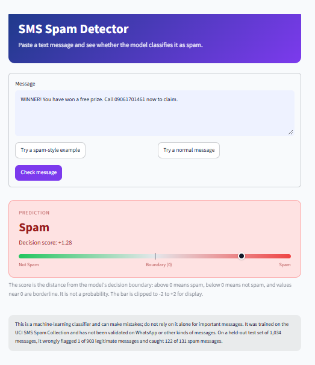
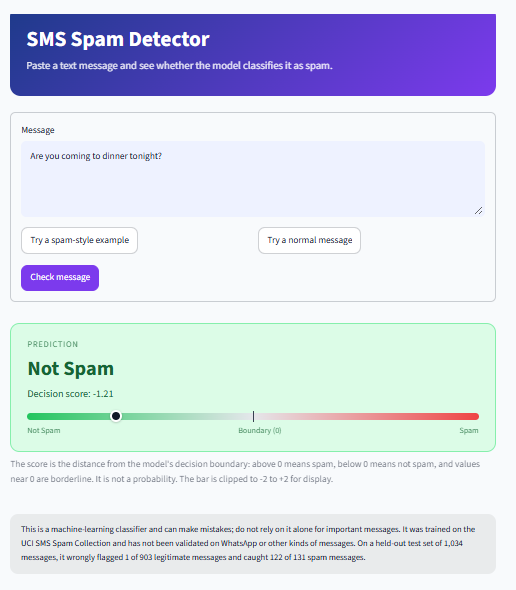
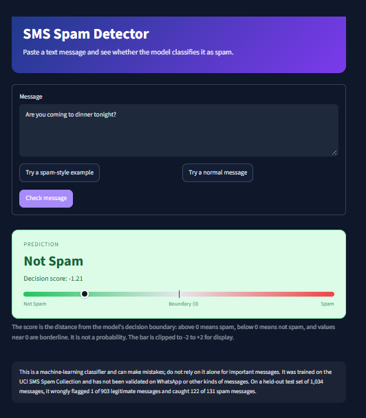

# SMS Spam Detector

A machine-learning application that classifies a text message as **Spam** or **Not Spam**. It is built on the UCI SMS Spam Collection with scikit-learn and served through a Streamlit interface.

| Spam example | Normal message | Dark mode |
|---|---|---|
|  |  |  |

> This is a portfolio project. The model is a classical machine-learning classifier and can make mistakes. It was trained and evaluated on SMS data only and has not been validated on WhatsApp or other message types.

## Results at a glance

Final evaluation on a held-out test set of 1,034 messages that was not used for any model choice or tuning:

| Class | Precision | Recall | F1 | Messages |
|---|---:|---:|---:|---:|
| Not spam (ham) | 0.9901 | 0.9989 | 0.9945 | 903 |
| Spam | 0.9919 | 0.9313 | 0.9606 | 131 |

Accuracy 0.9903, macro F1 0.9776.

| | Predicted ham | Predicted spam |
|---|---:|---:|
| **Actual ham** | 902 | 1 |
| **Actual spam** | 9 | 122 |

One legitimate message was wrongly flagged as spam, and nine spam messages were missed.

## Dataset

- **Source:** [UCI SMS Spam Collection](https://archive.ics.uci.edu/dataset/228/sms+spam+collection). The original download files are kept in `data/` (`readme`, `sms+spam+collection.zip`); the working file is `data/raw/SMSSpamCollection` (tab-separated: label, message).
- **Size:** 5,572 messages. After removing 403 exact duplicates (none had conflicting labels), 5,169 remain: 4,516 ham and 653 spam (about 87% / 13%).
- **Split:** stratified 80/20 split with `random_state=42`: 4,135 development messages and 1,034 test messages.

## Method

1. **Exploratory analysis** (notebook): class imbalance, message length, word and phrase frequencies, digits, punctuation, currency symbols, capitalisation, URLs and domains. Spam is more likely to contain long digit sequences, the pound sign, all-caps words and URLs. Ham is more conversational.
2. **Representation:** TF-IDF, with case and punctuation preserved (`lowercase=False`) and no stop-word removal, stemming or digit removal, so signals found in the analysis are not discarded.
3. **Model selection:** all comparisons used 5-fold stratified cross-validation on the 4,135 development messages, with the TF-IDF vectorizer fitted inside each fold. The test set was kept untouched until the end.

| Representation (LinearSVC, C=10) | Spam F1 (5-fold CV mean) |
|---|---:|
| Word unigrams | 0.9430 |
| Word unigrams + bigrams | 0.9436 |
| **Character n-grams (`char_wb`, 2-5)** | **0.9664** |
| Word + character n-grams | 0.9625 |

Multinomial Naive Bayes (alpha=0.01) reached a cross-validated spam F1 of 0.9401 on word features, below the Linear SVM. Logistic Regression was weaker on a single validation split.

4. **Final model:** `TfidfVectorizer(analyzer="char_wb", ngram_range=(2, 5), lowercase=False)` followed by `LinearSVC(C=10.0, max_iter=5000)`, fitted on all 4,135 development messages and saved as one scikit-learn pipeline (`models/spam_pipeline.joblib`). The exact saved pipeline produced the test results above.

## Using the app

The app shows a Spam / Not Spam prediction and a **decision score**. The score is the distance from the model's decision boundary: above 0 means spam, below 0 means not spam, and values near 0 are borderline. It is **not a probability**, because a linear SVM does not produce one.

## Setup

Requires Python 3.10. On Windows (cmd), from the project folder:

```bat
python -m venv env
env\Scripts\activate
python -m pip install -r requirements.txt
```

Run the app:

```bat
streamlit run app.py
```

Run the tests:

```bat
python -m pytest tests -v
```

Use the model from Python:

```python
from src.spam_detector.prediction import load_model, predict_message

model = load_model()
print(predict_message("Are you coming to dinner tonight?", model))
# {'label': 'ham', 'decision_score': ...}
```

The saved model was created with scikit-learn 1.7.2 and should be loaded with that version (pinned in `requirements.txt`).

## Project structure

```text
Spam Detector/
├── data/
│   ├── raw/SMSSpamCollection
│   ├── readme
│   └── sms+spam+collection.zip
├── notebooks/
│   └── spam_detection.ipynb     # analysis, experiments and decisions
├── src/spam_detector/
│   └── prediction.py            # load the model and classify a message
├── models/
│   └── spam_pipeline.joblib     # fitted TF-IDF + LinearSVC pipeline
├── tests/
│   └── test_prediction.py
├── app.py                       # Streamlit interface
├── requirements.txt
└── README.md
```

## Limitations

- **Data:** the training data is SMS only, and may not reflect contemporary SMS traffic or other messaging platforms such as WhatsApp. No claim is made about performance on them.
- **Dataset-specific cues:** the analysis found strong dataset-specific patterns, for example the pound sign appears in about 33% of spam but 0.1% of ham. How far the model relies on such cues was not tested.
- **Missed spam:** recall is about 93%. The nine missed test messages were mostly short, borderline or conversational-sounding spam. Several were close to the decision boundary.
- **Small test set:** the test set has 131 spam messages, so each miss moves spam recall by about 0.8 points. Treat the test figures as a single estimate. The cross-validated spam F1 was 0.9664 against 0.9606 on the test set.
- **One false positive:** an automated "added you as a contact" notification was flagged as spam.
- **No probabilities:** the model gives a decision score, not a calibrated probability.
- **Scope:** local use only. There is no live message monitoring, API integration or deployment.